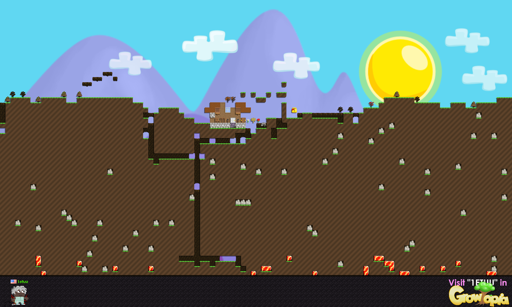

# FLWorldRender - Turns a world into a .png, the /renderworld way

<a href="media/screenshot.png"></a>

License:  BSD style attribution, see [LICENSE.md](LICENSE.md)

This is the little command line program behind /renderworld on Flowtopia.  Your server dumps a world into a .rtwr scene file, this reads it and spits out a .png with the sky, hills, blocks, shadows, trees and the bar at the bottom with the owner's avatar and flag.

It's all software rendering.  No GPU, no window, no Proton SDK checkout needed, so it's happy running on a cheap Linux box next to your server.  The art is read straight out of the client's own .rttex files, so nothing from the client is included here, you point it at your own copy.

I wrote it for Flowtopia, then figured other people running their own servers might want a /renderworld too, so here it is.

Features:

* Draws the whole world at half size by default (a 100x60 world comes out 1600x960), or any scale you want
* Blocks that connect to their neighbors (dirt, cave walls, platforms, etc) pick the right edge piece
* Block shadows, flipped blocks and painted blocks
* Trees grow based on their age, ripe ones show their fruit
* Water and fire
* The bottom bar: "Visit "WORLDNAME" in", the logo, and the owner (plus anyone with access who's in the scene) with their avatar, name and country flag
* Avatars wear their clothes, long hand items included
* Can cut out a rect of tiles instead of the whole world

Dropped items aren't drawn, the real /renderworld leaves them out too.  The code for them is still in there (DrawDroppedStuff) if you want them anyway.

Mostly undocumented features:

* Set RTWR_NO_TREES to skip trees
* RTWR_SHADOW_DX, RTWR_SHADOW_DY and RTWR_SHADOW_ALPHA override the shadow offset and alpha
* RTWR_BAR_ALPHA overrides how dark the bottom bar is
* RTWR_AVATAR_X, RTWR_AVATAR_Y and RTWR_AVATAR_SCALE move and size the avatar in the bar, RTWR_ARM_FRONT and RTWR_ARM_BACK change the arm angles

All of these are handy when you're comparing against a real render.

Oct 29th, 2026 - V1.00 Released

# How to use it

```
FLWorldRender <world.rtwr> <out.png> [-res <client resources>] [-owner <name>] [-country <cc>] [-scale <0.5>] [-scene <x,y,w,h>]
```

* <b>-res</b> - The client's resource folder, the one with the <b>game</b> and <b>interface</b> folders in it.  If you don't set it, it looks where the client lives on macOS
* <b>-owner</b> - A name to show in the bottom bar when nobody from the scene owns the world
* <b>-country</b> - Country code for that name's flag (us, tr, jp, etc)
* <b>-scale</b> - 0.5 is the default, 1 gives you full 32 pixel tiles
* <b>-scene</b> - x,y,w,h in tiles.  Cuts that rect out and skips the bottom bar

Example:

```
FLWorldRender START.rtwr start.png -res "C:\path\to\the\client"
```

If it worked it prints something like <b>Rendered START (1600x960) to start.png</b> and returns 0.  Anything else returns 1 and says what went wrong.

It needs the two Century Gothic .rtfont files from the client's interface folder, if it can't find those it won't even start.  A missing .rttex just means that thing doesn't get drawn.

# Hooking it up to your server

Roughly what Flowtopia does:

1. Player types /renderworld
2. The server writes the world to a .rtwr file (format below)
3. Runs FLWorldRender on it as its own process
4. Uploads the .png somewhere and sends the player the link

Don't make your game loop sit and wait for it, run it on the side and send the link when it's done.

# The .rtwr scene format

Everything is little endian.  A "string" is a uint16 length followed by that many bytes, no null at the end.

Header:

* char[4] - "RTWR"
* uint32 - version, 1 to 3 (write 3)
* string - world name
* int32 - width in tiles
* int32 - height in tiles (anything bigger than 1000x1000 gets refused)
* uint16 - base weather
* uint16 - current weather

Items:

* uint32 - how many items follow

Only the items the scene uses need to be in here.  That's blocks, backgrounds, trees, the clothes the players wear and, for trees, the fruit (the item right before the tree's id).  Most of these come straight from items.dat.

* uint16 - item id
* string - texture file name, relative to the <b>game</b> folder
* uint8 - texture x (in 32 pixel cells)
* uint8 - texture y
* uint8 - spread type (how it connects to neighbors: 2, 3, 4, 5, 7 and 9 are handled)
* uint8 - seed base
* uint8 - seed overlay
* uint8 - tree base
* uint8 - tree leaves
* int32 - seed color, as items.dat stores it
* int32 - seed overlay color
* int32 - grow time
* uint8 - clothing type (version 2+)

Tiles, width * height of them, row by row from the top left:

* uint16 - foreground
* uint16 - background
* uint16 - flags.  0x0020 flipped, 0x0400 water, 0x1000 fire, 0x2000 red paint, 0x4000 green paint, 0x8000 blue paint
* uint32 - tree age, same unit as grow time.  0xFFFFFFFF if it's not a tree
* uint8 - fruit count
* uint8 - frame, gets added to the texture x for things like open chests and dice faces (version 3+)

Dropped items (read, but not drawn):

* uint32 - how many follow
* uint16 - item id
* uint8 - amount
* float - x, in world pixels (32 per tile)
* float - y

Owner and players (version 2+):

* uint32 - owner's user id, 0 if nobody
* uint32 - how many user ids with access follow, then that many uint32s
* uint32 - how many players follow

For each player:

* int32 - net id
* uint32 - user id
* string - name, color codes work
* string - country code, anything after a | is ignored
* uint32 - flags.  1 means "this is the player who asked for the render"
* float - x
* float - y
* uint16[10] - clothing: hat, shirt, pants, feet, face, hand, back, hair, necklace, ances
* uint32 - skin color, 0 for the default

The bottom bar shows the owner first, then anyone in the access list.  If none of them are in the scene it shows the player with flag 1, and if there isn't one of those either, whatever you passed with -owner.

# How to compile it from source

With CMake (Windows/MSVC, also works on macOS and Linux):

```
cmake -B build
cmake --build build --config Release
```

zlib is included in <b>shared/util/zlib</b> like Proton does it, so there's nothing else to download.

Or with plain make (this one links the system's zlib instead):

```
make
```

and you get <b>build/FLWorldRender</b>.

# Things I should add, probably

* Weather backgrounds, right now it always draws the sunny default sky no matter what the weather machine says
* Drawing the players standing in the world (their positions are already in the file, they just aren't drawn yet)

If something's broken or renders different from the real thing, open an issue and I'll try to help if I can.

# Credits and links

Written for [Flowtopia](https://github.com/FlowtopiaServer)

* Seth A. Robinson ([Codedojo](https://www.codedojo.com), Seth's blog) - The .rttex and .rtfont formats this reads come from his [Proton SDK](https://github.com/SethRobinson/proton), and the code follows Proton's layout and naming (RTFont, SoftSurface, LogMsg and friends).  This product includes software from the Proton SDK developed by Seth A. Robinson ( www.rtsoft.com ).  Seth had nothing to do with this tool though, so please don't send him bug reports about it
* [zlib](https://zlib.net) by Jean-loup Gailly and Mark Adler, see its license in <b>shared/util/zlib</b>
* [setplannergt.com](https://setplannergt.com) - avatar layer order
